<div align="center">

# NovelTL

[Русский](README.md) · **English**

**Visual novel translator for Windows — translation right on top of the game**

Captures dialogue text from the running game and shows the translation on a semi-transparent box over the dialogue window.
Japanese, English, Chinese, Korean and Russian — from any of them into any other.
No manual hook codes, no command line — three wizard steps and you are playing.

[](../../releases/latest)


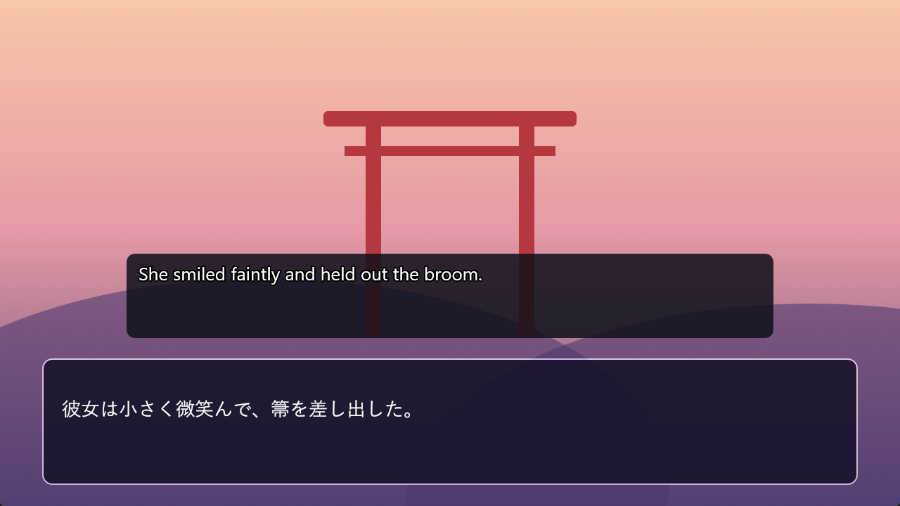

</div>

---

## Features

### 📚 Game library
- 📚 **Game cards in the main window.** Icon from the exe, “Played: …”, “Lines read: N”, a Play button and a “···” menu.
- ▶️ **One-button launch.** From the game folder, via Steam or a “Custom launch command” (DMM, Locale Emulator); NovelTL connects by itself.

### 🌐 Translation
- 🗺️ **5 languages, any direction.** Japanese, English, Chinese, Korean, Russian; source language per game (or “Auto”).
- 🌐 **DeepL and Google.** Google without a key, DeepL with one (uses previous lines as context); if DeepL refuses, Google takes over.
- 🆓 **Free options.** Local AI ([Ollama](https://ollama.com), LM Studio), offline, and Microsoft Translator (2M characters a month).
- ⚖️ **Second translation.** A smaller line under the main one from another translator, to cross-check the meaning.
- 📖 **Glossary.** Names and terms come out the way you set them (“灯里 → Akari”); DeepL and local AI also get a “who is this” note.
- 🎨 **A color for each character's name.** “Color” column in the glossary: the name in that color on the overlay and in history.
- 📊 **DeepL limit counter.** Settings → Translation: characters used this month; a warning at 90 %.
- 💾 **Cache and cleanup.** Repeats are instant and use no limits; KiriKiri tags, doubled characters and repeated phrases are removed.

### 🪟 Overlay on top of the game
- 🪟 **Stays out of the way.** Clicks go through it, it never steals focus, it follows the game window.
- 🖱️ **Button bar on hover.** Translate again, copy translation, show original, pin/move, settings, hide, menu.
- 👻 **Dimmed bar.** Make the buttons almost transparent so they do not distract.
- 🔒 **Lock.** Open it to move and resize the box during play; close it and the box stays put.
- 🔤 **Original in small text under the translation.** Optional.
- 🖌️ **Your own look.** Font, size, colors and opacity, with a live preview.
- 🎭 **Ready-made styles.** Classic, Subtitles, Like in the game, Minimal; plus corner rounding, border, centering and shadow.
- ✨ **Fade-in and typing effect.** Fade-in is on by default, typing is optional.
- ⏪ **Past lines on the overlay.** Ctrl+Alt+←/→ or the mouse wheel while the lock is open; a “‹ N back” label.

### 🎓 For Japanese learners
- 🈶 **Furigana** over kanji in the dialogue history.
- 🈷️ **Furigana on the overlay.** Over the original, if “Show original under translation” is on; word meaning on hover.
- 📚 **Word meanings on hover.** Verbs are shown in dictionary form; the [JMdict](https://www.edrdg.org/jmdict/j_jmdict.html) dictionary (© EDRDG, CC BY-SA 4.0) downloads with one button.
- 🗂️ **“Add to Anki”** on right click, via AnkiConnect.

### 🎯 Text capture
- 🎯 **Automatic hook detection.** Click through 3–4 lines; it finds the dialogue thread and a separate names thread.
- 🔍 **OCR.** If capture finds nothing, text is read from the screen with Windows OCR (needs a language pack with text recognition).
- 📋 **Clipboard mode.** Translates whatever you copy, for unsupported games and Linux.
- 🧽 **Filters.** Fragments removed from the game text before translation.
- 🔌 **A profile for each game.** Start the game and NovelTL connects by itself, no wizard.

### ⚙️ Settings and comfort
- 🗂️ **New settings window.** Sections with icons on the left, options in cards: Appearance, Translation, Overlay, Network, Hotkeys, Japanese, General.
- 🎨 **Theme.** Mode: Follow Windows, Dark, Light or Custom (your own background, card and text colors).
- 🌈 **Accent color.** Six presets or any color you like.
- 🌍 **Interface in 5 languages.** Русский, English, 日本語, 中文, 한국어.
- ⌨️ **Hotkeys in the game.** Ctrl+Alt+S settings, Ctrl+Alt+H overlay, Ctrl+Alt+R translate again.
- 🟢 **Tray icon with a dot.** Green — game connected, yellow — looking for text.
- 🔔 **Update check.** Once a day; a “Version … is out” banner in the main window; can be turned off in Settings → General.
- 📜 **History, log, statistics.** Last 50 lines, a text log per game and a reading counter.
- 🛡️ **Network.** SOCKS5 / HTTP proxy with login, network interface choice, for when Google limits requests over a VPN.
- 👤 **Profile.** Your own nickname and avatar in the main window.
- 🪶 **Lightweight.** A single Rust exe: ~6 MB installer, ~90 MB of memory, starts in under a second.

Made first of all for YUZUSOFT games on the KiriKiri engine (Senren\*Banka and others); LunaHook supports many other engines as well.

## Screenshots

<table>
<tr>
<td width="50%">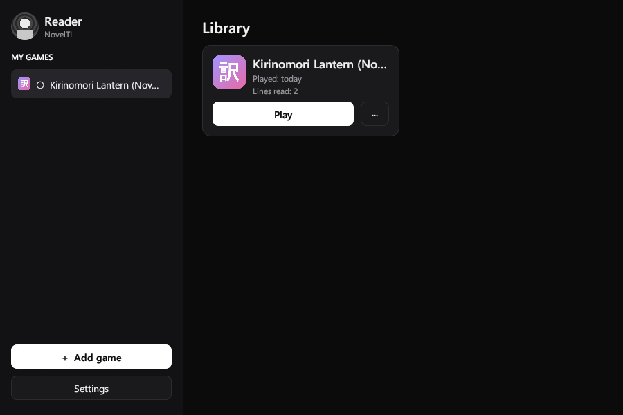<br><sub>Game library: cards, a Play button and the “···” menu</sub></td>
<td width="50%">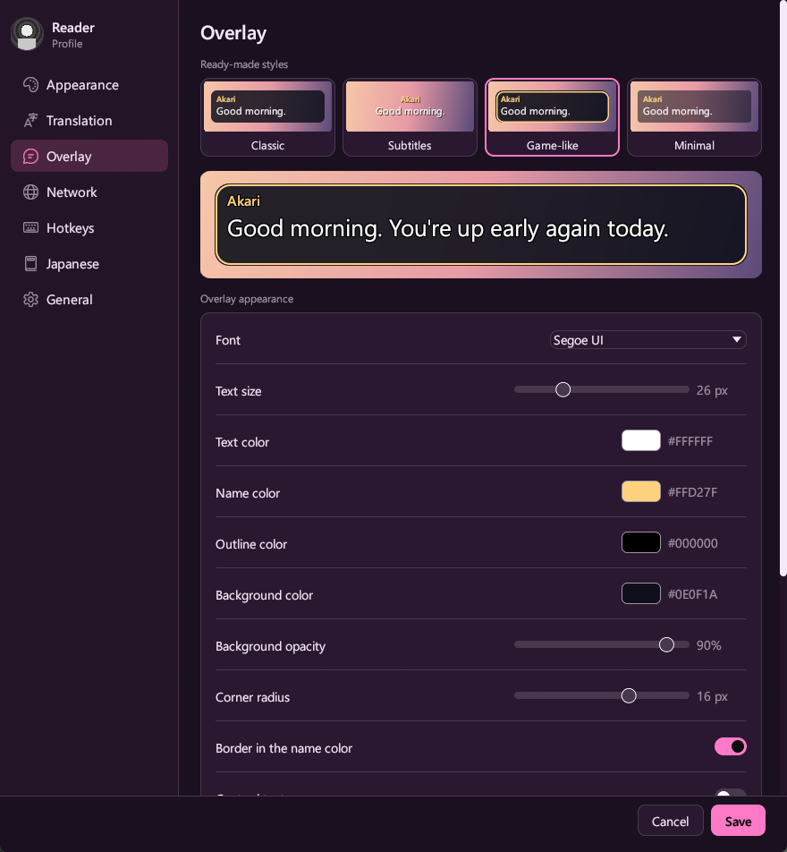<br><sub>“Overlay”: the “Like in the game” style and style cards</sub></td>
</tr>
<tr>
<td width="50%">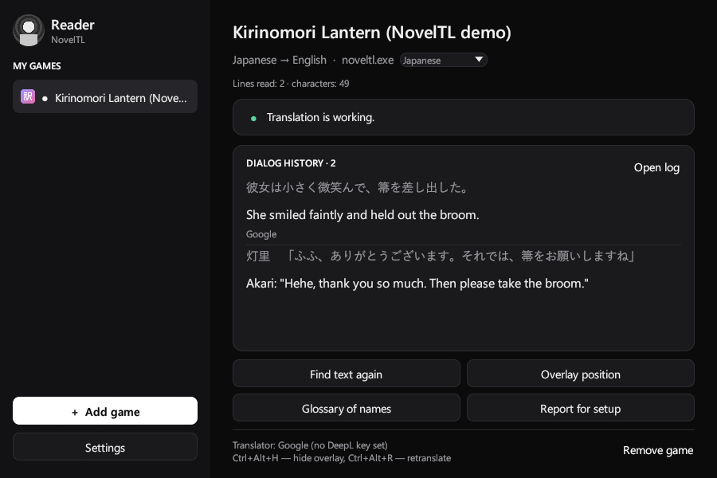<br><sub>Main window: the game is connected, original and translation are shown</sub></td>
<td width="50%">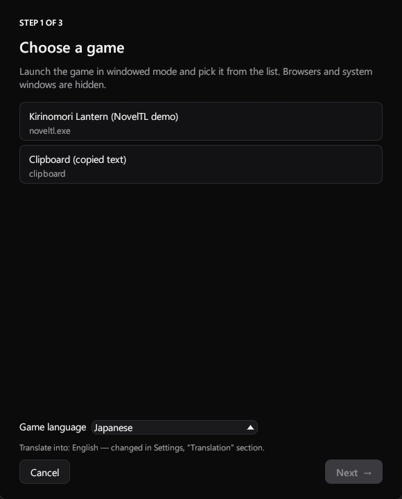<br><sub>Wizard, step 1 — choose the game window and language</sub></td>
</tr>
<tr>
<td>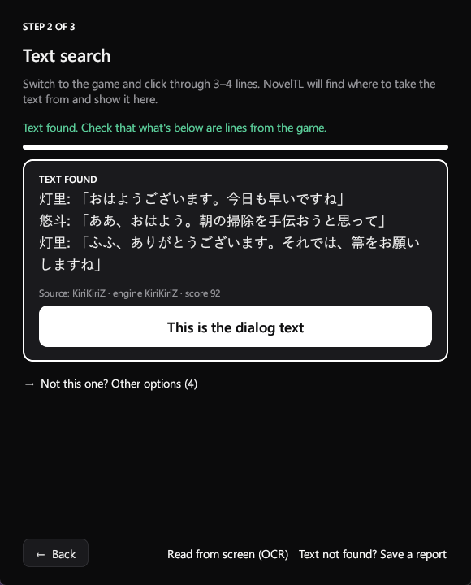<br><sub>Step 2 — the program found the dialogue text by itself</sub></td>
<td>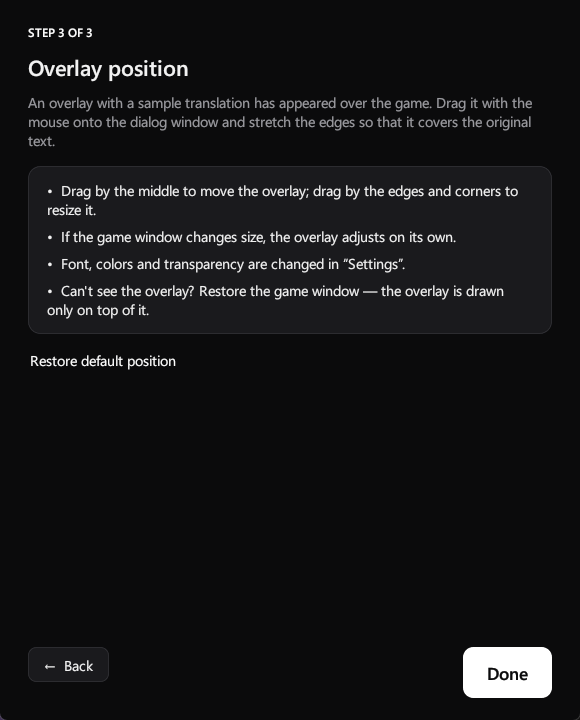<br><sub>Step 3 — drag the box onto the dialogue window</sub></td>
</tr>
<tr>
<td>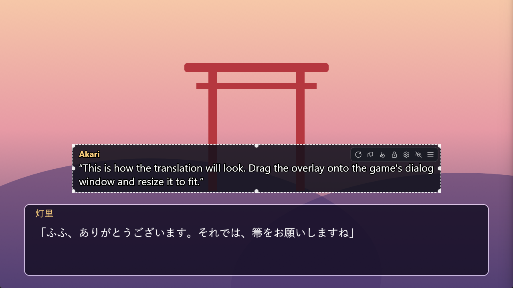<br><sub>Overlay in setup mode: the button bar on hover</sub></td>
<td>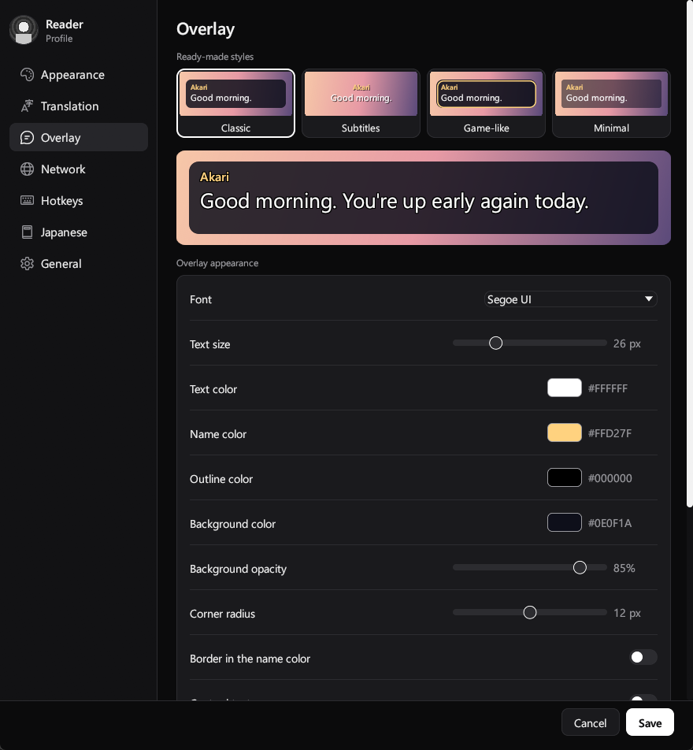<br><sub>Settings, “Overlay” section</sub></td>
</tr>
<tr>
<td>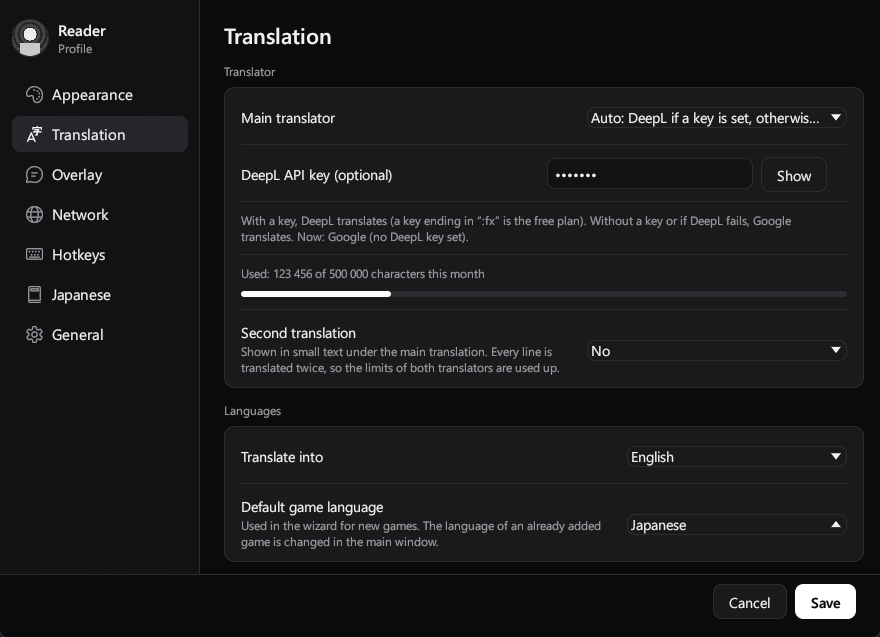<br><sub>Settings, “Translation”: translator and languages</sub></td>
<td>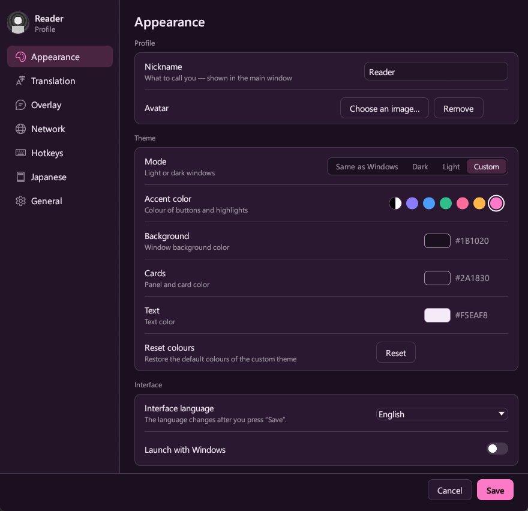<br><sub>“Appearance”: mode, accent and a custom palette</sub></td>
</tr>
<tr>
<td>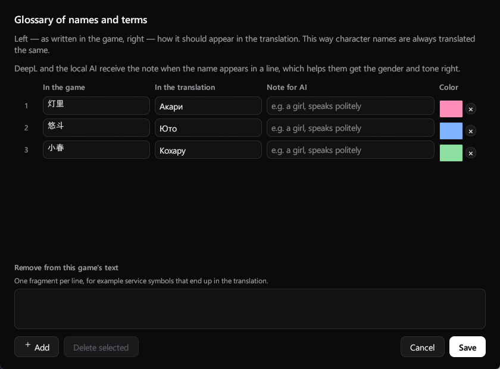<br><sub>Glossary of names and terms</sub></td>
<td><br><sub>The translation box over the game</sub></td>
</tr>
</table>

<details>
<summary><b>Other settings sections</b> (click to expand)</summary>
<br>
<p align="center">
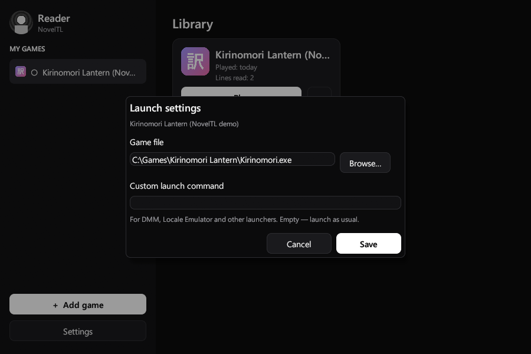
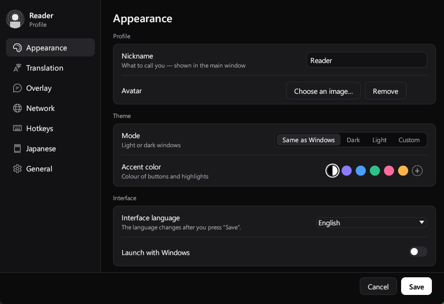
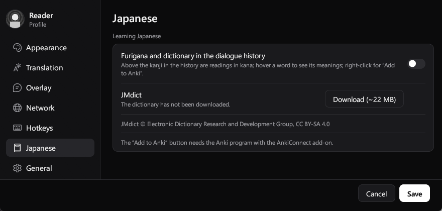
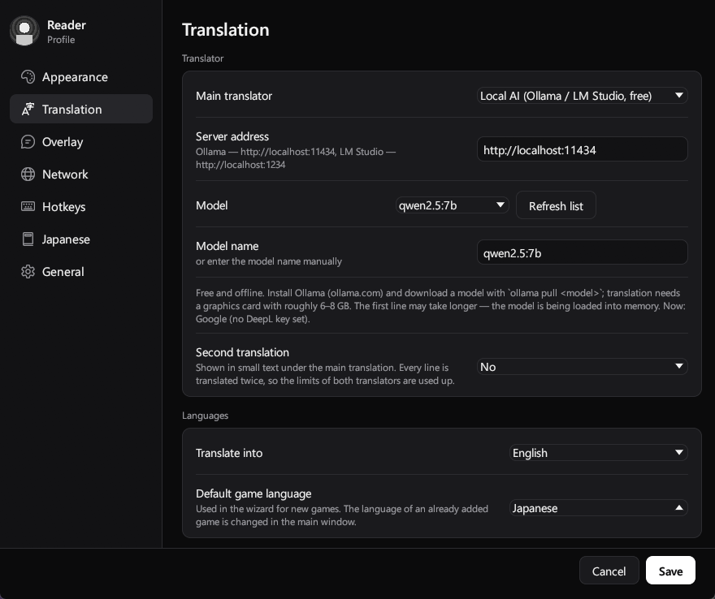
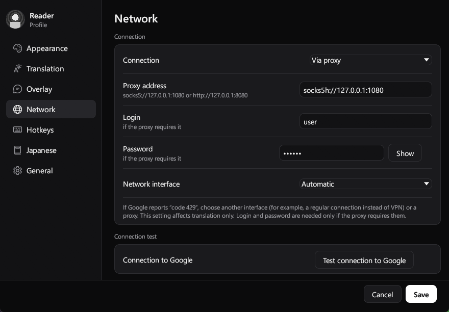
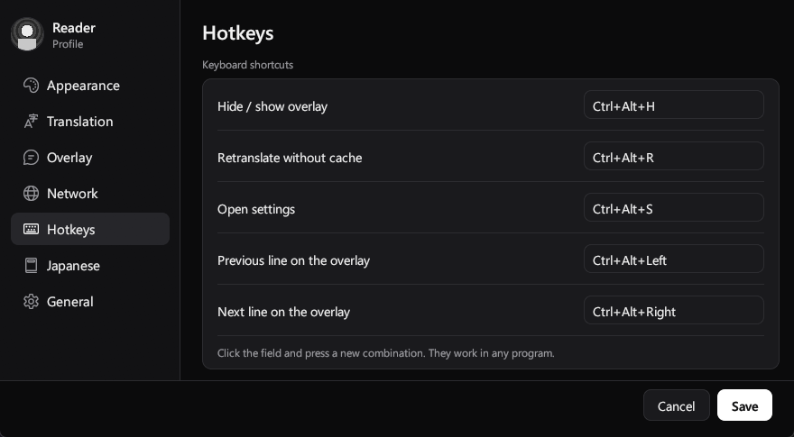
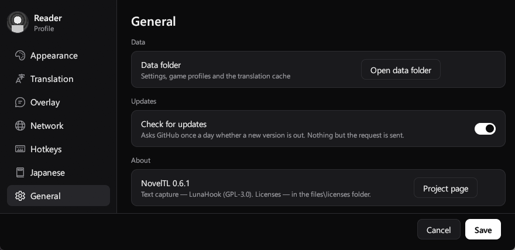
</p>
</details>

## Installation

1. Download `NovelTL-Setup-….exe` from the [**Releases**](../../releases/latest) page.
2. Run it. No administrator rights needed — the program installs into your user folder.
   The installer is not digitally signed, so Windows may show “Windows protected your PC” → **More info** → **Run anyway**.
3. To update, simply install the new version over the old one: game profiles and settings are kept.

> [!NOTE]
> Windows Defender is sometimes suspicious of programs that connect to other processes (this is how text capture works).
> If the game “does not respond” at step 2, add the NovelTL folder and the game folder to Defender exclusions.

### Linux

Download `NovelTL-…-linux-x86_64.tar.gz` from the [**Releases**](../../releases/latest) page, extract it and run `./noveltl` (`./install.sh` adds it to the application menu).

Differences from Windows:
- **No automatic text capture** — LunaHook exists only for Windows. In the wizard choose “Clipboard (copied text)”: NovelTL translates everything copied to the clipboard. Usually the game runs through Wine/Proton and a text hooker (for example Textractor in the same Wine) copies the lines to the clipboard.
- **The overlay is a separate always-on-top window.** Its place is set with the mouse: open the lock — drag and stretch it, close the lock — clicks go to the game. Works on X11 (and XWayland, which NovelTL selects automatically); Steam Deck — in Desktop Mode.
- No tray icon and no global hotkeys — everything is in the ☰ menu on the overlay. Keys are stored unencrypted.

Details are in `README-Linux.txt` inside the archive. The Linux build is checked automatically, but nobody has tried it with real games on Linux yet — please report in [Issues](../../issues).

## How to use

1. Start the game **in windowed mode** and get to a place with dialogue.
2. Start NovelTL → **“Add game”**. The interface language can be changed in Settings → Appearance.
3. **Step 1.** Choose the game window and the source language. If Windows asks for administrator permission, allow it.
4. **Step 2.** Click through 3–4 lines in the game. When the dialogue text appears in the window, press **“This is the dialogue text”**.
   Wrong text? Open “Other options” and pick the right line.
5. **Step 3.** Drag the box onto the game's dialogue window, stretch it by the edges and press **“Done”**.

Next time just start NovelTL and the game — it connects automatically. You can also launch the game with the **“Play”** button on its card in the library.

Want to look at the program without a game? Run `NovelTL.exe --demo` (or the “demo mode” shortcut in the Start menu).

### Hotkeys

| Keys | Action |
|---|---|
| <kbd>Ctrl</kbd>+<kbd>Alt</kbd>+<kbd>S</kbd> | open settings |
| <kbd>Ctrl</kbd>+<kbd>Alt</kbd>+<kbd>H</kbd> | hide / show the overlay |
| <kbd>Ctrl</kbd>+<kbd>Alt</kbd>+<kbd>R</kbd> | translate the line again, bypassing the cache |
| <kbd>Ctrl</kbd>+<kbd>Alt</kbd>+<kbd>←</kbd> | previous line on the overlay |
| <kbd>Ctrl</kbd>+<kbd>Alt</kbd>+<kbd>→</kbd> | next line on the overlay |

The shortcuts can be changed in Settings.

### Languages, translator and network

- **Target language** — Settings → Translation → “Translate into”. The overlay immediately shows the current line in the new language.
- **Source language** is chosen in the wizard when adding a game, and for an existing game — in the main window next to its name. “Auto” detects the language from the text.
- **Translator** — in the same place: “Auto” (DeepL if a key is set, otherwise Google), “DeepL only”, “Google only”, “Microsoft Translator” or “Local AI”.
- **Local AI (free, offline):** install [Ollama](https://ollama.com), download a model (for example `ollama pull qwen2.5:7b`), choose “Local AI” in Settings, press “Refresh list” and pick the model. You need a graphics card with roughly 6–8 GB; the first line takes longer — the model is loaded into memory. LM Studio works too: address `http://localhost:1234`.
- **Microsoft Translator (free tier):** in the Azure portal create a “Translator” resource with the F0 tier, copy the key and region from “Keys and Endpoint” into Settings.
- **Google** works without a key. If you see “Google temporarily limited requests (code 429)” — wait, turn off the VPN, set a proxy or a DeepL key.
- **DeepL**: paste the API key into Settings → Translation. A free key ends with `:fx`. In “Auto” mode, on error 403/456 translation automatically goes through Google.
- **Proxy**: SOCKS5 or HTTP, with or without login and password. The “Check connection to Google” button shows right away whether it works.

## If the text is not captured

1. Without closing the game, click through 5–6 lines.
2. Press **“Report for setup”** in the main window — a folder with a `report_….json` file opens.
3. Create an [Issue](../../issues) and attach this file and a screenshot of the game, and describe what you see at step 2.

The report contains no DeepL key, no proxy login or password and no path to the game — it is safe to publish.

Common causes:
- **“The game did not respond within 10 seconds”** — add NovelTL and the game to Windows Defender exclusions, restart both programs.
- **The game runs as administrator** — run NovelTL the same way.
- **The overlay is not visible** — the game must be in windowed, not fullscreen mode.

## Where data is stored

Everything is next to the program, in the `data` folder:

| Path | Contents |
|---|---|
| `data\profiles` | game profiles: hook, language, overlay position, glossary |
| `data\cache` | translation cache, one file per game |
| `data\reports` | setup reports |
| `data\settings.json` | general settings |

🔒 The DeepL key and the proxy password are stored **encrypted** with Windows means (DPAPI) — they can be read only under your account on this computer. The program sends no data anywhere except the dialogue text to the chosen translator and the daily update check: it contacts api.github.com, sends nothing but the request, and can be turned off in Settings → General.

## Building from source

Requirements: [rustup](https://rustup.rs) with the `x86_64-pc-windows-gnu` toolchain, MinGW-w64 (for example `winget install BrechtSanders.WinLibs.POSIX.UCRT`), and [Inno Setup 6](https://jrsoftware.org/isinfo.php) for the installer.

```powershell
cd noveltl-rs
powershell -ExecutionPolicy Bypass -File build.ps1            # tests + program + installer
powershell -ExecutionPolicy Bypass -File build.ps1 -NoInstaller
```

The ready folder is `noveltl-rs\dist\NovelTL`, the installer is in `dist_installer\`.
The program structure is described in [`noveltl-rs/ARCHITECTURE.md`](noveltl-rs/ARCHITECTURE.md) (in Russian).

The first NovelTL version was written in Python (PySide6); it has been removed from the repository and remains in the git history (last commit with it: `ae7a790`, version 0.4.3).

## Credits and license

Text capture — [**LunaHook**](https://github.com/HIllya51/LunaHook) from the [LunaTranslator](https://github.com/HIllya51/LunaTranslator) project (by HIllya51), used without changes. It is based on Textractor and MinHook. Their license texts are in [`files/licenses`](files/licenses).

NovelTL is distributed under the **GPL-3.0-or-later** license — see [LICENSE](LICENSE).

The licenses of the bundled Rust libraries and fonts are collected at build time into `THIRD-PARTY-RUST.txt` (in the installed program: `files\licenses`; in the Linux archive: next to the program).

NovelTL does not modify game files. Use it with games you own legally.
