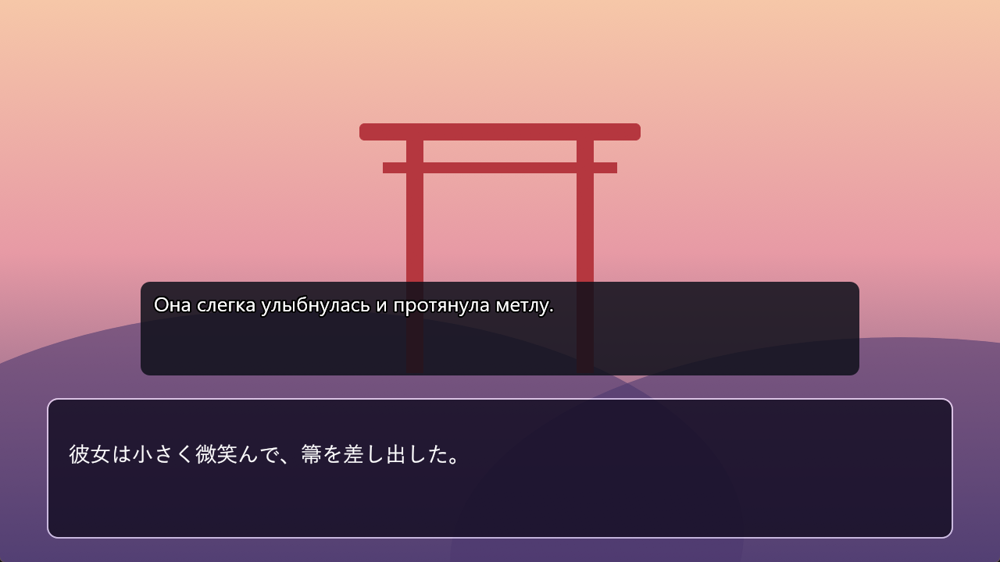
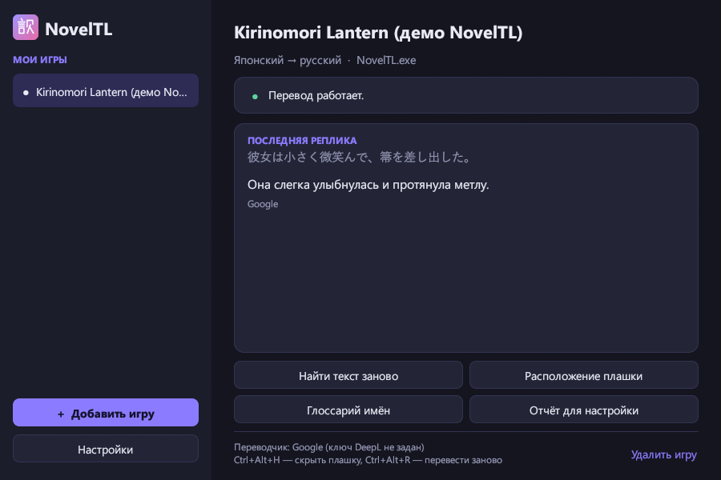
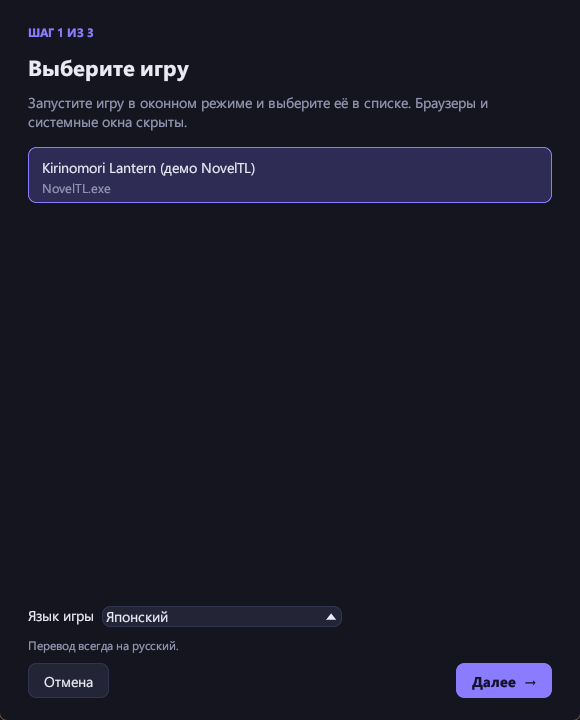
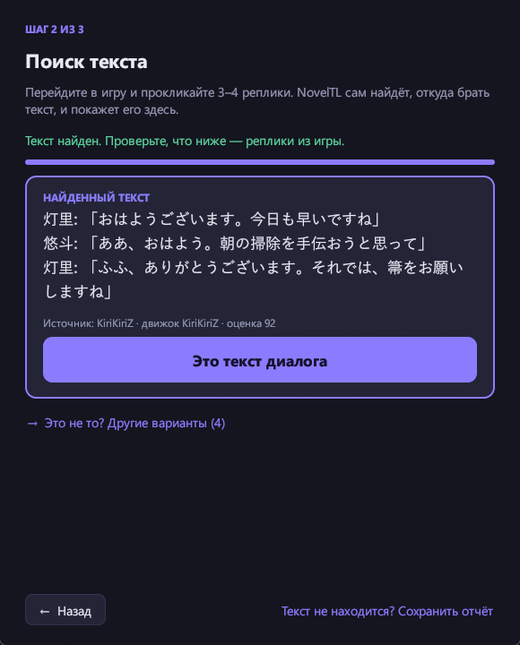
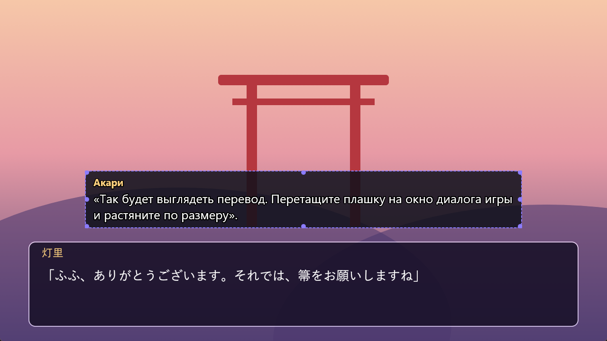
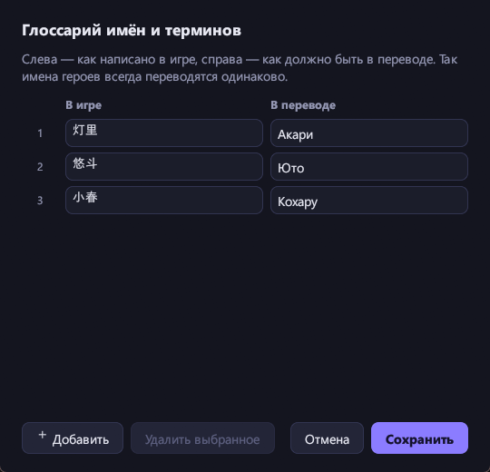
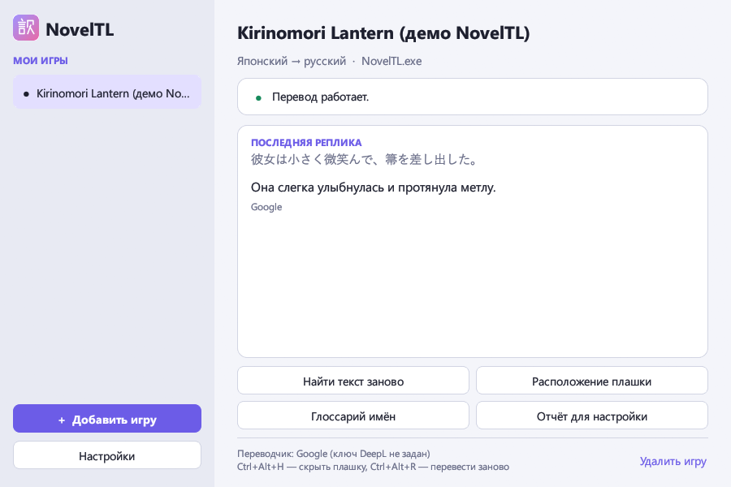
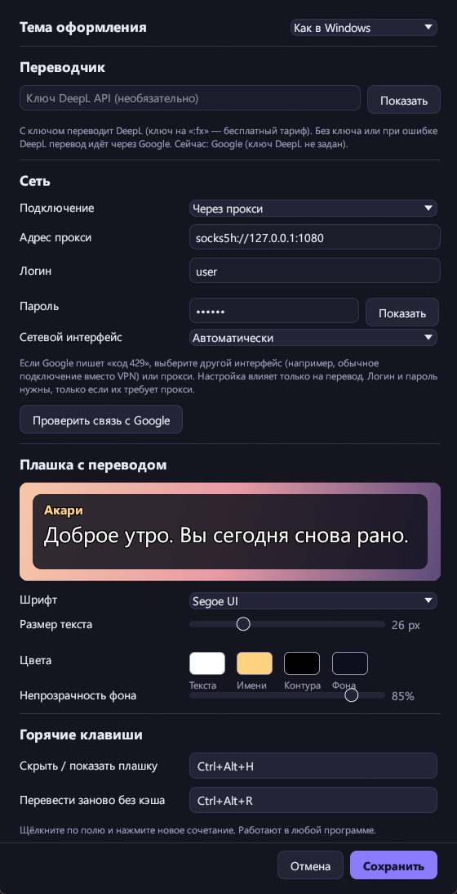

<div align="center">

# NovelTL

**Переводчик визуальных новелл для Windows — перевод прямо поверх игры**

Ловит текст реплик из запущенной игры и показывает русский перевод на полупрозрачной плашке поверх окна диалога.
Без настройки хуков вручную, без командной строки — три шага мастера, и можно играть.

[](../../releases/latest)




</div>

---

## Возможности

- 🎯 **Автоподбор хука.** Прокликайте 3–4 реплики — программа сама найдёт поток с текстом диалога и отдельно поток с именами персонажей.
- 🪟 **Плашка поверх игры.** Прозрачная для мыши, не перехватывает фокус, привязана к окну игры и двигается вместе с ним. Размер и место задаются один раз мышкой.
- 🌐 **DeepL и Google.** Без ключа переводит Google. С ключом DeepL (бесплатный тариф тоже подходит) — DeepL с учётом контекста предыдущих реплик; если DeepL откажет, программа сама перейдёт на Google и скажет об этом.
- 📖 **Глоссарий.** Имена и термины переводятся так, как вы задали: «灯里 → Акари».
- 💾 **Кэш переводов.** Повторные реплики показываются мгновенно и не тратят лимиты переводчика.
- 🧹 **Очистка текста.** Убирает служебные теги движка KiriKiri, удвоенные символы и повторы фраз.
- 🔌 **Профиль на каждую игру.** Запустили игру — NovelTL подключится сам, без мастера.
- 🛡️ **Сеть.** Прокси SOCKS5 / HTTP с логином и паролем, выбор сетевого интерфейса — на случай, если Google ограничивает запросы через VPN.
- 🎨 **Тёмная и светлая тема** или «как в Windows».
- ⌨️ **Горячие клавиши** работают прямо в игре; значок в трее.
- 🪶 **Лёгкая.** Один exe на Rust: установщик ~6 МБ, ~90 МБ памяти, запуск меньше секунды.

Сделана в первую очередь под игры YUZUSOFT на движке KiriKiri (Senren\*Banka и др.); LunaHook поддерживает и многие другие движки.

## Скриншоты

<table>
<tr>
<td width="50%"><br><sub>Главное окно: игра подключена, видно оригинал и перевод</sub></td>
<td width="50%"><br><sub>Мастер, шаг 1 — выбор окна игры и языка</sub></td>
</tr>
<tr>
<td><br><sub>Шаг 2 — программа сама нашла текст диалога</sub></td>
<td><br><sub>Шаг 3 — плашку перетаскивают на окно диалога</sub></td>
</tr>
<tr>
<td><br><sub>Глоссарий имён и терминов</sub></td>
<td><br><sub>Светлая тема</sub></td>
</tr>
</table>

<details>
<summary><b>Настройки</b> (нажмите, чтобы развернуть)</summary>
<br>
<p align="center"></p>
</details>

## Установка

1. Скачайте `NovelTL-Setup-….exe` со страницы [**Releases**](../../releases/latest).
2. Запустите. Права администратора не нужны — программа ставится в папку пользователя.
   У установщика нет цифровой подписи, поэтому Windows может показать «Windows защитила ваш компьютер» → **Подробнее** → **Выполнить в любом случае**.
3. Обновление — просто установите новую версию поверх: профили игр и настройки сохранятся.

> [!NOTE]
> Защитник Windows иногда настороженно относится к программам, которые подключаются к другим процессам (так работает перехват текста).
> Если игра «не отвечает» на шаге 2 — добавьте папку NovelTL и папку игры в исключения Защитника.

## Как пользоваться

1. Запустите игру **в оконном режиме** и дойдите до места с диалогом.
2. Запустите NovelTL → **«Добавить игру»**.
3. **Шаг 1.** Выберите окно игры и язык оригинала. Если Windows спросит разрешение администратора — согласитесь.
4. **Шаг 2.** Прокликайте в игре 3–4 реплики. Когда в окне появится текст диалога — нажмите **«Это текст диалога»**.
   Показано не то? Откройте «Другие варианты» и выберите нужную строку.
5. **Шаг 3.** Перетащите плашку на окно диалога игры, растяните за края, нажмите **«Готово»**.

В следующий раз достаточно запустить NovelTL и игру — подключение произойдёт само.

Хотите посмотреть программу без игры? Запустите `NovelTL.exe --demo` (или ярлык «демо-режим» в меню «Пуск»).

### Горячие клавиши

| Клавиши | Действие |
|---|---|
| <kbd>Ctrl</kbd>+<kbd>Alt</kbd>+<kbd>H</kbd> | скрыть / показать плашку |
| <kbd>Ctrl</kbd>+<kbd>Alt</kbd>+<kbd>R</kbd> | перевести реплику заново, минуя кэш |

Сочетания можно поменять в настройках.

### Переводчик и сеть

- **Google** работает без ключа. Если появилось «Google временно ограничил запросы (код 429)» — подождите, отключите VPN, укажите прокси или ключ DeepL.
- **DeepL**: вставьте ключ API в «Настройки». Бесплатный ключ оканчивается на `:fx`. При ошибке 403/456 перевод автоматически идёт через Google.
- **Прокси**: SOCKS5 или HTTP, с логином и паролем или без. Кнопка «Проверить связь с Google» сразу покажет, работает ли.

## Если текст не ловится

1. Не закрывая игру, прокликайте 5–6 реплик.
2. Нажмите **«Отчёт для настройки»** в главном окне — откроется папка с файлом `report_….json`.
3. Создайте [Issue](../../issues) и приложите этот файл, снимок экрана игры и опишите, что видно на шаге 2.

В отчёте нет ключа DeepL, логина и пароля прокси и пути к игре — его можно спокойно публиковать.

Частые причины:
- **«Игра не ответила за 10 секунд»** — добавьте NovelTL и игру в исключения Защитника Windows, перезапустите обе программы.
- **Игра запущена от имени администратора** — запустите так же и NovelTL.
- **Плашки не видно** — игра должна быть в оконном, а не в полноэкранном режиме.

## Где хранятся данные

Всё лежит рядом с программой, в папке `data`:

| Путь | Что там |
|---|---|
| `data\profiles` | профили игр: хук, язык, положение плашки, глоссарий |
| `data\cache` | кэш переводов, отдельный файл на игру |
| `data\reports` | отчёты для настройки |
| `data\settings.json` | общие настройки |

🔒 Ключ DeepL и пароль прокси хранятся **зашифрованными** средствами Windows (DPAPI) — прочитать их можно только под вашей учётной записью на этом компьютере. Программа никуда не отправляет данные, кроме текста реплик выбранному переводчику.

## Сборка из исходников

<details>
<summary>Rust-версия (основная)</summary>

Нужно: [rustup](https://rustup.rs) с тулчейном `x86_64-pc-windows-gnu`, MinGW-w64 (например, `winget install BrechtSanders.WinLibs.POSIX.UCRT`), для установщика — [Inno Setup 6](https://jrsoftware.org/isinfo.php).

```powershell
cd noveltl-rs
powershell -ExecutionPolicy Bypass -File build.ps1            # тесты + программа + установщик
powershell -ExecutionPolicy Bypass -File build.ps1 -NoInstaller
```

Готовая папка — `noveltl-rs\dist\NovelTL`, установщик — `dist_installer\`.
Устройство программы описано в [`noveltl-rs/ARCHITECTURE.md`](noveltl-rs/ARCHITECTURE.md).

</details>

<details>
<summary>Python-версия (первая, сохранена для истории)</summary>

```powershell
python -m venv .venv
.\.venv\Scripts\pip install PySide6 pyinstaller pytest requests pysocks psutil
.\.venv\Scripts\python -m pytest -q tests
.\.venv\Scripts\python main.py --demo
.\.venv\Scripts\python build.py            # exe через PyInstaller + установщик
```

</details>

### Структура репозитория

```
noveltl-rs/           Rust-версия (основная)
  noveltl-core/       ядро: очистка текста, автоподбор хука, переводчики, кэш, профили, сеть
  noveltl/            окна (egui), плашка (Direct2D), LunaHook, трей, горячие клавиши
noveltl/, main.py     Python-версия (PySide6)
tests/                тесты Python-версии
files/                движок LunaHook и тексты лицензий
installer/            скрипт установщика Inno Setup
shots/, shots_light/  скриншоты интерфейса
ИНСТРУКЦИЯ.txt        короткая инструкция, входит в установщик
```

## Благодарности и лицензия

Перехват текста — [**LunaHook**](https://github.com/HIllya51/LunaHook) из проекта [LunaTranslator](https://github.com/HIllya51/LunaTranslator) (автор HIllya51), используется без изменений. В его основе — Textractor и MinHook. Тексты их лицензий лежат в [`files/licenses`](files/licenses).

NovelTL распространяется по лицензии **GPL-3.0-or-later** — см. [LICENSE](LICENSE).

NovelTL не изменяет файлы игр. Пользуйтесь им с играми, которые у вас есть легально.
